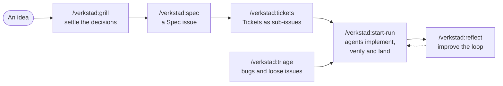
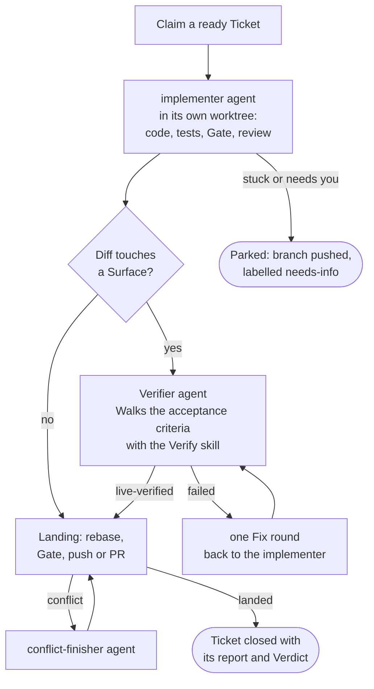
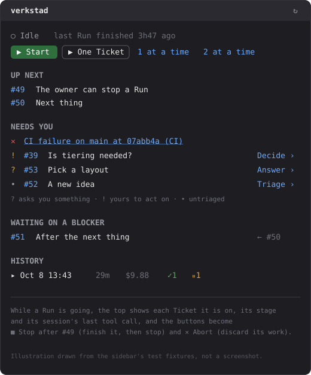

# verkstad

A Claude Code plugin for a solo developer's agent loop. You talk an idea through, turn it into a Spec and then into Tickets on GitHub. verkstad then hands each ready Ticket to an agent in its own git worktree. A change lands on your base branch only after it passes your Gate and, when it touches something a user can see, after an independent Verifier has seen it working.



It is a work in progress, built by one person for their own Projects. Expect it to change.

- [GLOSSARY.md](GLOSSARY.md): the words verkstad uses and what each means. The capitalised words below (Spec, Ticket, Gate, Surface, …) are defined there.
- [docs/adr/](docs/adr/): the decisions that shape it, and why.
- [docs/contract.md](docs/contract.md): what a Project tells verkstad about itself.
- [docs/formats/](docs/formats/): the formats of the Specs, Tickets, glossary, ADRs and agent docs verkstad writes.

## What you need

- [Claude Code](https://docs.claude.com/en/docs/claude-code), signed in.
- Node 24 or later, git, and the [GitHub CLI](https://cli.github.com/) (`gh auth login` done).
- Linux: Landing takes a lock with `flock(1)` from util-linux.
- A GitHub repo for the Project. verkstad keeps Specs and Tickets as GitHub issues, linked with native sub-issues and `blocked_by` relations.

## Install

The repo is its own plugin marketplace. Add it from GitHub, or from a local checkout, and install the plugin:

```bash
claude plugin marketplace add beijer/verkstad
```

```bash
claude plugin install verkstad@verkstad
```

From a local checkout, pass its path instead: `claude plugin marketplace add ~/code/verkstad`.

Inside Claude Code the plugin puts the `verkstad` CLI on the PATH, so its agents and your skills can run it. Outside Claude Code, run `bin/verkstad` from the checkout.

## A walkthrough

### 1. Make the repo a Project

Open Claude Code in your repo and run:

```
/verkstad:setup
```

Setup reads the repo (lockfile, `package.json` scripts, CI workflows, what it shows a user) and asks you about what it can't work out. Then it writes:

| File | What it holds |
| --- | --- |
| `.claude/harness.json` | The Contract for the scripts: the base branch, the Gate's steps, the Landing mode (`push` or `pull-request`) and the Surfaces. |
| `docs/agents/project.md` | The Contract for the agents: what an agent must know to work here, in prose. |
| `docs/agents/*.md` | Where issues live, which labels mean what, where the glossary and ADRs are. |
| `.gitignore` | `.claude/verkstad/` (logs, Verdicts, Evidence) and `.claude/worktrees/` (the agents' worktrees). |

It also creates the five triage labels on GitHub (`needs-triage`, `needs-info`, `ready-for-agent`, `ready-for-human`, `wontfix`) and runs the Gate and the Frontier once to prove it all works.

A minimal `harness.json` looks like this:

```json
{
  "baseBranch": "main",
  "landing": "push",
  "gate": {
    "steps": [
      { "name": "install", "command": "npm ci", "unlessExists": "node_modules" },
      { "name": "typecheck", "command": "npm run typecheck" },
      { "name": "test", "command": "npm test" }
    ]
  },
  "surfaces": [
    { "name": "ui", "globs": ["src/ui/**", "public/**"] }
  ],
  "verify": "verify-myapp"
}
```

Run `/verkstad:setup` again any time to check the Project. It changes nothing it finds correct.

**Starting from nothing?** Run `/verkstad:setup` in an empty directory. Once you agree, it runs `git init`, creates the GitHub repo with `gh repo create` and pushes a first commit with an empty Gate and no Surfaces. The first Ticket scaffolds the Project and adds its tests to the Gate.

### 2. Teach the Verifier your app (when it has a Surface)

A **Surface** is anything a user or another system observes: a UI, a CLI's output, an HTTP API, a generated file. When a Ticket's diff touches one of a Surface's globs, the Verifier has to see it working before it lands. It does that with the Project's own Verify skill:

```
/verkstad:create-verify
```

This writes `.claude/skills/verify-<app>/`. The skill tells an agent how to launch your app, check that it is healthy (the Doctor), drive it one command at a time, and capture Evidence (screenshots, output, files). It seeds a Feature map of what users can do and proves the skill with one Walk. When the app has drifted from the map, `/verkstad:maintain-verify` audits it and brings it back in line.

A Project with no Surfaces yet (a library, a new repo) skips this step. When a Ticket later adds the first UI or CLI command, the Run stops and tells you to declare the Surface with `/verkstad:setup` and then run `/verkstad:create-verify`.

### 3. Plan the work

```
/verkstad:grill
```

Describe the idea. The grill interviews you in numbered rounds, each question with a recommended answer, until every decision is settled.

```
/verkstad:spec
```

Turns the conversation into a **Spec**, a GitHub issue that describes the whole piece of work. A Spec is never implemented directly.

```
/verkstad:tickets
```

Breaks the Spec into **Tickets**. Each is a vertical slice an agent can finish in one session, with acceptance criteria and its blockers. You get a numbered breakdown to approve or revise. Only then are the Tickets published, as sub-issues of the Spec, labelled `ready-for-agent` and linked with native `blocked_by` relations.

Bugs and ideas that arrive outside a Spec go through triage:

```
/verkstad:triage
```

It lists the issues that need attention, reproduces bugs where it can and recommends a label. When an issue becomes `ready-for-agent` it posts an Agent Brief. Nothing is posted or relabelled without your yes.

The **Frontier** is what is ready now: open Tickets labelled `ready-for-agent`, unassigned, with no open blocker. Check it any time:

```bash
verkstad frontier
```

### 4. Run it

From the Project's main checkout:

```
/verkstad:start-run
```

The skill shows the plan (`verkstad run --dry-run`): which Tickets are ready, which come next, and each implementer's model, effort and budget. It asks you once whether to start, optionally with `--max <n>` Tickets or a `--budget <usd>` per session. Then it starts `verkstad run` and watches it.

The Run works two Tickets side by side by default (`--parallel <n>`, capped by `parallel` in the Contract), each in its own worktree. Every decision about a Ticket is made in code, not by a model:



- The **implementer** writes the change and its tests, runs the Gate and reviews its own branch with `verkstad:review`. The **Verifier** sees the Ticket, the diff and the Verify skill, but never the implementer's report, and it never edits source. It records a **Verdict**: `live-verified`, `failed`, or `blocked` when it needs a human (real hardware, say).
- **Landing** rebases onto the latest base branch, checks the Verdict still applies, runs the Gate (or reuses a pass already recorded for the same tree), then either pushes and closes the Ticket, or opens a pull request for you to merge.
- A Ticket that can't go on is **Parked**: its branch is pushed, it is labelled `needs-info` with the question, and anything it blocks waits. Answer it and the next Run resumes it.

When the Run ends, the skill reports what landed (with commits), what was Parked and why, and what waits on you, including a red CI on the base branch.

### 5. Watch it in the sidebar

In a Project, the verkstad sidebar opens beside the transcript (`/verkstad:sidebar` opens it again):

<p align="center"></p>

- **The Run**: idle, or the Tickets it is on, their stage and their session's last tool call. **▶ Start** launches a Run detached, so it outlives your session. **Stop** finishes the Tickets in flight, then stops (`verkstad run --stop`). **✕ Abort** discards their work so the next Run starts them fresh (`verkstad run --abort`).
- **Up next**: the Frontier.
- **Needs you**: a red CI, a pull request to merge, issues labelled for you, issues to triage. **Triage ›**, **Answer ›** and **Decide ›** open a triage session on that issue.
- **Waiting on a blocker**: Tickets and what they wait on.
- **History**: past Runs, with duration, cost, how many landed (✓) and how many were Parked (⏸). Each opens to its Tickets.

The sidebar reads GitHub only while it is shown, at most once every two minutes across all your sessions in the Project. ↻ reads it now.

### 6. Improve the loop

```
/verkstad:reflect
```

After a Run, reflect reads its event log, its sessions' transcripts (through `verkstad run-log`), its Gate logs and Verdicts. It proposes changes to the routing, the prompts, the skills or the Contract, each with the evidence behind it, and applies only the ones you approve. The Run's last line tells you whether it left anything to reflect on.

## Other skills

| Skill | What it does |
| --- | --- |
| `/verkstad:audit` | Audits a repo or a folder for bugs, security holes, untested risky code, slow paths and what to delete. Ranked, in plain English, and it changes no code. Then offers to file the findings as issues. |
| `/verkstad:review` | Reviews the changes since a commit against the issue they implement. The implementer runs it before reporting; you can run it on any branch. |
| `/verkstad:merge-conflicts` | Resolves a stopped merge or rebase, keeping both sides' intent. |
| `/verkstad:maintain-verify` | Audits the Verify skill and its Feature map against the app as it is now. |

## The CLI

The skills drive the `verkstad` CLI. You rarely need it directly, but it is there:

```bash
verkstad frontier
```

Lists the Tickets ready now, in progress and waiting. `--json` prints the same as data.

```bash
verkstad run --dry-run
```

Shows what a Run would do, claiming nothing.

```bash
verkstad gate
```

Runs the Gate in the current worktree. It prints only failures and keeps the full log in `.claude/verkstad/`.

```bash
verkstad labels
```

Creates any of the five triage labels the repo lacks.

A Project whose issues name their parent and blockers in text (`## Parent`, `## Blocked by`) converts them once to native links, which is what the Frontier reads:

```bash
verkstad convert-links --dry-run
```

Shows what it would link and what it would skip, and why. Run it without `--dry-run` to add the links; a second run adds nothing.

`verkstad help` lists every subcommand.

## Develop

Node 24, no build step: `npm ci`, then `npm run typecheck` and `npm test`. [CLAUDE.md](CLAUDE.md) has the conventions.
